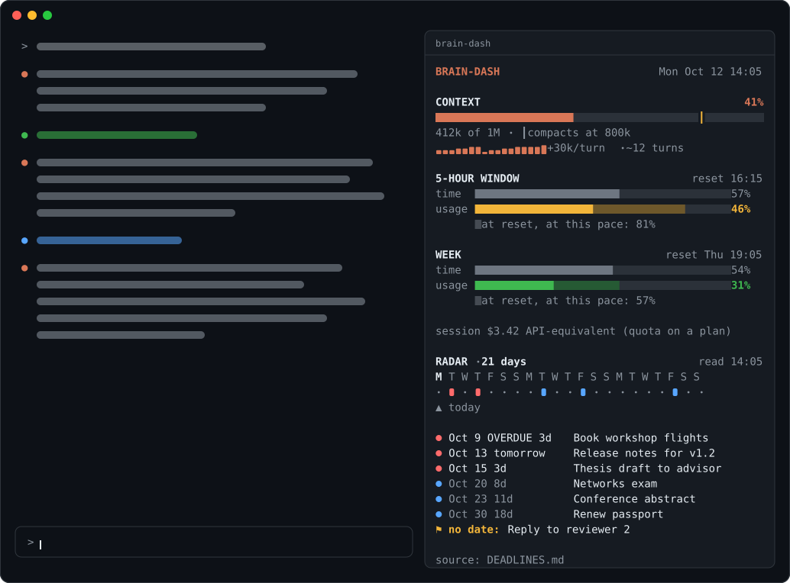
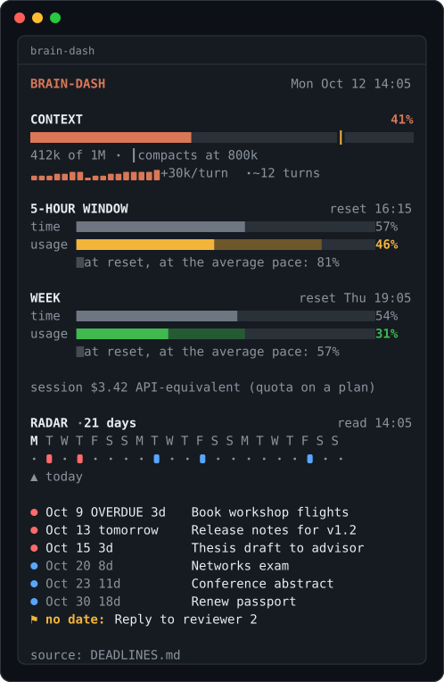
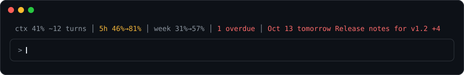
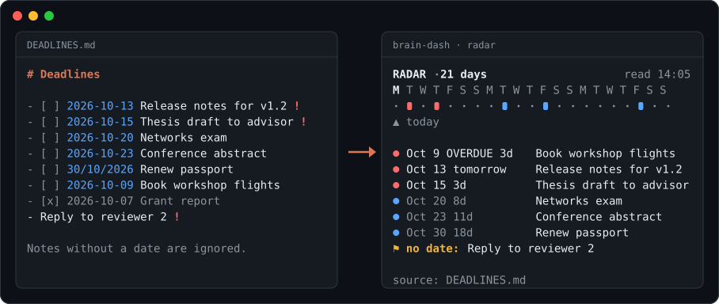

<div align="center">

# brain-dash

**See how much room your Claude Code session has left, and what is due next, without leaving the code.**

[](LICENSE)
[](#install)
[](#what-it-touches)



</div>

## Why

Long sessions fail in two quiet ways. The context fills up and compacts in the middle of a task, or
a plan limit runs out an hour before the reset, and you only find out when it happens. Meanwhile
the deadline that matters this week lives in another app.

brain-dash keeps all of that in a pane next to the conversation. It doesn't only show where you
are. It also projects where you will be at your current pace, so you can wrap up, compact or
switch tasks before you hit the wall.

## What you get



**Context.** A bar with the auto-compact threshold marked, a sparkline of context per turn, and
roughly how many turns are left at the current pace. Only growth since the last compaction or
`/clear` counts as pace, and subagent turns are left out.

**Plan limits.** The 5-hour and weekly windows, each shown as elapsed time against usage. The
shaded part of the usage bar is where you will be at reset if you keep the average pace so far.
If that projection goes past 100%, the pane tells you when the window runs out.

**Deadline radar.** A 21-day calendar and a list of what is due, read from a plain
`DEADLINES.md` in your project or from a command you choose. Overdue items stay visible for two
weeks. Critical ones stay until you tick them off.

**Colour means something.** Amber is a warning: the context is past 75% or 5 turns from the
limit, a window is heading past 80%, or a deadline is 3 to 4 days away. Red means act now: the
context is past 90% or 2 turns from the limit, a window is past 90% or projected to run out, or a
deadline is overdue, critical or 2 days away or less.

<br clear="right">

When the pane is closed, or the terminal is too narrow for it, the same summary sits in one line
above the prompt:



## Install

At the prompt of a Claude Code terminal session:

```
/plugin install brain-dash --marketplace sillss1/brain-dash
```

Answer `y` to add the marketplace and pick a scope (user scope gives you the pane in every
project). If `/brain` is not available straight away, run `/reload-plugins` or start a new
session.

**Requirements.** Built and tested against Claude Code 2.1.296. Mods are an early-access part of
Claude Code, and their API may change between releases. The pane sits beside the conversation in
the fullscreen renderer (`/tui fullscreen`). In the classic renderer it opens in a frame above
the prompt.

## Quick start

1. Install it (above). The usage part works straight away.
2. Create `DEADLINES.md` at the root of your project:

   ```markdown
   - [ ] 2026-10-15 Thesis draft to advisor !
   - [ ] 2026-10-20 Networks exam
   ```

3. Finish a turn, or press `r` in the pane. The radar appears.

`/brain` opens and closes the pane at any time.

## The deadline radar



### File format

One deadline per line. Everything else in the file is ignored, so it can hold notes too.

| You write | It means |
|---|---|
| `2026-10-15 Submit the report` | A deadline. The date can be anywhere in the line, and the rest of the line becomes the text. |
| `15/10/2026 Submit the report` | The same: `DD/MM/YYYY` works too. |
| `... Submit the report !` | **Critical** (a `!` at the end of the line): red in the radar, and kept on screen after it is overdue. |
| `- [ ] 2026-10-15 ...` | Markdown lists and task boxes are fine. |
| `- [x] 2026-10-15 ...` | Done. A ticked box is skipped. |
| `- Email the advisor !` | A critical item with no date yet. It is listed under "no date". |
| `# Heading`, lines without a date | Ignored. |

The radar re-reads the file at the end of the turn after you save it.

### Using your own command

If your deadlines already live somewhere else, such as a script, a calendar export or a task tool,
set the `radar_command` option. Its output replaces the file. The command:

- runs at the project root, at startup, every 30 minutes, and when you press `r` in the pane;
- runs **without a shell**, so for pipes or `&&` wrap it: `sh -c 'your | pipeline'`;
- has 20 seconds to finish;
- prints either the line format above, or JSON.

The JSON can be a plain array of deadlines or an object:

```json
{
  "deadlines": [
    { "date": "2026-10-15", "text": "Thesis draft to advisor", "critical": true },
    { "date": "2026-10-20", "text": "Networks exam" }
  ],
  "undated": ["Reply to reviewer 2"],
  "warnings": ["3 tickets waiting for review"]
}
```

`warnings` are shown as free-text lines under the list. Portuguese keys work as well (`prazos`,
`data`, `texto`, `critico`, `sem_data`, `avisos`), and unknown fields are ignored.

A minimal script, for example `scripts/deadlines.py`:

```python
import json
print(json.dumps([{"date": "2026-10-15", "text": "Thesis draft", "critical": True}]))
```

Then set `radar_command` to `python scripts/deadlines.py`.

**Failures are loud on purpose.** The radar turns red and shows the reason, and where it came
from, if any of these happens:

- the command exits non-zero;
- it times out;
- it prints invalid JSON;
- the file cannot be read.

An empty radar always means there is nothing due, never that the radar failed to run.

## Options

Set them in `/config` under brain-dash. Changing one reloads the mod with the new value.

| Option | Default | What it does |
|---|---|---|
| `radar_file` | `DEADLINES.md` | The deadlines file, relative to the project root. A `.json` file is read as JSON. |
| `radar_command` | *(empty)* | A command whose output replaces the file (see above). |
| `radar_days` | `21` | How many days ahead the calendar and the list cover (1–90). |

With no file and no command there is simply no radar. The line above the prompt shows usage only,
and the pane explains how to add deadlines.

## How the numbers are worked out

- **Turns left** = (compaction threshold − current context) ÷ average growth per turn, over up to
  the last 6 turns since the last drop. If auto-compact is off, the full window is the limit.
- **Projection at reset** = used + (used ÷ time elapsed in the window) × time remaining. It is
  linear on purpose. It's an estimate, and it stays hidden for the first 5% of a window, when the
  average means little.
- **Runs out at** is shown only when the projection passes 100%. It is when, at the same pace,
  usage would reach 100%.
- **session $** is the API-equivalent cost of the session as Claude Code reports it. On a
  subscription plan this is quota, not money.

All of this is computed locally from the usage figures Claude Code already reports. Nothing is
requested from any server.

## What it touches

| | |
|---|---|
| Network | None. |
| Files written | None. |
| Files read | Your deadlines file. |
| Processes | Only `radar_command`, and only if you set it. |
| Prompts and tool calls | Not observed. It reads only the session's usage measurements (context, rate limits, cost). |

`claude plugin validate brain-dash` prints exactly which engine calls the mod makes, if you want to
check this yourself.

## Troubleshooting

| Symptom | Cause and fix |
|---|---|
| The pane does not open at startup | Unasked, a pane needs the fullscreen renderer and at least 144 columns (110 once you have opened it by hand). A toast says when it did not fit. `/brain` opens it at any width. |
| `RADAR FAILED` | The command or the file failed. The pane shows the reason and the source underneath. |
| No radar at all | There is no `DEADLINES.md` (or `radar_file`) at the project root, and no `radar_command`. |
| Times look wrong | Times and "today" use your machine's time zone. |
| Two panels or two bands | Two copies of the mod are loaded, for example an installed one and a `--plugin-dir` copy. Keep one. |

## Development

```
.
├── .claude-plugin/marketplace.json   makes this repository installable
├── brain-dash/
│   ├── .claude-plugin/plugin.json    manifest and options
│   ├── hooks/register.tsx            events, the pane, the band, /brain
│   ├── hooks/calc.ts                 projections and drawing (pure)
│   ├── hooks/radar.ts                deadline sources and parsing (pure)
│   ├── types/index.d.ts              the state contract
│   └── tests/register.test.ts        24 tests
└── docs/render.ts                    regenerates the images in this README
```

```bash
claude plugin test brain-dash        # run the tests
claude plugin validate brain-dash    # what the engine will load and refuse
claude --plugin-dir ./brain-dash     # try a local copy in one session
npx tsx docs/render.ts               # redraw docs/images/*.svg
```

The tests cover the projections, both deadline formats, the radar window, the drawing, and the mod
running inside the engine on both the terminal and Desktop surfaces. The README images are drawn
by `docs/render.ts` from the mod's own drawing functions and sample data, so they match what the
pane shows.

Source comments and internal names are in Portuguese. Everything a user sees is in English.

## License

[MIT](LICENSE) © 2026 Francisco Antunes
